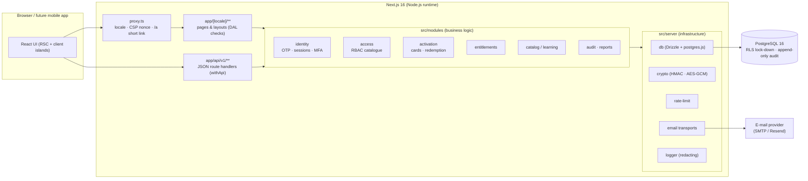
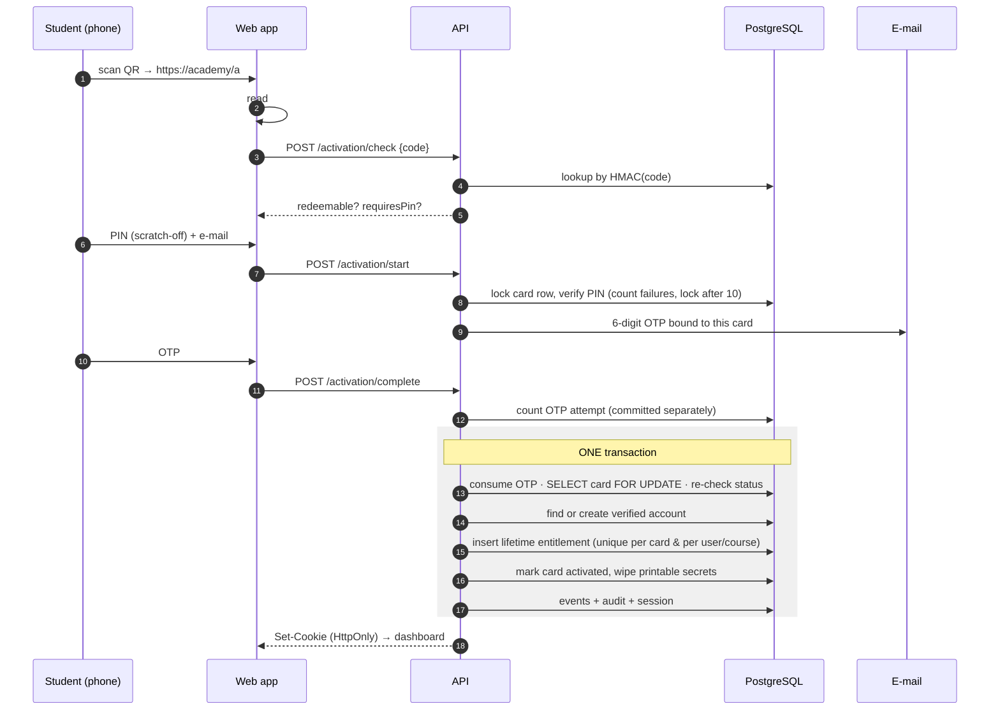

# Architecture

> Premium e-learning academy — QR-card activation, lifetime course access, community,
> live sessions and full administration. Arabic (RTL) first, French, English-ready.

## 1. Style: a modular monolith

One Next.js application, one PostgreSQL database, strict internal module boundaries.
Microservices would add network failure modes, distributed transactions and DevOps cost
without solving a problem this product has. The critical invariant of the business —
**one card ⇒ exactly one lifetime entitlement** — is enforced inside a single ACID
transaction, which a monolith makes trivial and a distributed system makes hard.

### Layers and rules

| Layer | Path | Responsibility | May import |
|---|---|---|---|
| Routing / UI | `src/app`, `src/components` | Rendering, input parsing, HTTP concerns | modules, server/http, i18n |
| Domain modules | `src/modules/*` | Business rules, authorisation checks, transactions | other modules' services, server/* |
| Infrastructure | `src/server/*` | DB, crypto, e-mail, rate limiting, logging, env | nothing app-specific |
| Shared (pure) | `src/shared`, `src/i18n`, `src/lib` | Enums, translations, client-safe helpers | nothing server-only |

* Every service that touches protected data takes an `Actor` and calls `assertCan(actor, permission)`.
  Pages and route handlers also check (defence in depth); hiding UI is never the control.
* Server-only modules import `server-only`, so secrets can never be bundled for the browser.
* Services accept an `Executor` (db or transaction) so they compose inside one transaction.

## 2. Request lifecycle

1. **`src/proxy.ts`** (network edge): redirects to a locale (`/` → `/ar`), resolves the QR short link
   `/a#CODE` → `/{locale}/activate#CODE`, issues a per-request CSP nonce, and does an *optimistic*
   redirect to sign-in when no session cookie exists.
2. **Pages/layouts** call `requirePageActor()` — the Data Access Layer entry point — which validates
   the session against the database (memoised per request with React `cache`).
3. **Route handlers** are wrapped by `withApi()`: request metadata (IP/UA/request id), CSRF origin
   check for unsafe methods, uniform JSON errors (`{ error: { code } }`), and `requireApiActor()`.
4. **Services** run business logic in transactions and append audit events.

## 3. Key flows

### 3.1 QR activation (the heart of the system)

Guarantees (all covered by tests in `tests/integration/activation.test.ts`):
* A used, revoked, expired, locked or unsold (when point-of-sale activation is on) card never grants access.
* Concurrent redemptions of one card serialise on the row lock; exactly one wins.
* Any failure rolls back everything — no consumed card without access, no access without a consumed card.
* Database constraints back this up: partial unique indexes on `course_entitlements`
  (one per card; one active per user+course) and CHECK constraints on card states.

### 3.2 Returning students

`Email → OTP → session`. The QR card is never needed again. Authentication (who you are) is separate
from entitlements (what you can access): a signed-in account without an active entitlement sees
only the "activate a card" call to action.

### 3.3 Staff

Same e-mail OTP sign-in, then a mandatory TOTP second factor (authenticator app, recovery codes),
valid for 12 hours per session (`STAFF_MFA_MAX_AGE_HOURS`). Every admin page and admin API checks it.

## 4. Data model

See [DATABASE.md](./DATABASE.md) for the ERD and table catalogue (66 tables covering identity,
RBAC, catalogue, learning, assessments, activation, entitlements, commerce, community,
notifications, live sessions, support, audit and compliance).

## 5. Cross-cutting concerns

| Concern | Implementation |
|---|---|
| i18n | `/[locale]` routing, typed dictionaries (`src/i18n/dictionaries`), `next/root-params`, logical CSS properties for RTL |
| Theming | CSS variables (OKLCH) in `globals.css`, light/dark via class + pre-paint script |
| Security headers | Nonce CSP (`proxy.ts`), HSTS, frame denial, nosniff, referrer and permissions policies (`next.config.ts`) |
| Observability | Structured JSON logs with secret redaction (`src/server/logger.ts`), request ids, `/api/health` |
| Rate limiting | Postgres fixed windows (`src/server/rate-limit.ts`), Redis-ready interface |
| E-mail | Provider-agnostic transports: SMTP, Resend HTTP API, dev outbox |
| Audit | Append-only `audit_logs` + `activation_events` (DB triggers forbid UPDATE/DELETE) |

## 6. Extensibility (future features)

| Future feature | Where it plugs in |
|---|---|
| More courses, bundles | Everything is `course_id`-scoped; cards target a course; entitlements per course |
| Paid memberships | `course_entitlements.source = 'subscription'` (+ a `subscriptions` table) |
| Online payments | `payments.provider = 'card_gateway'`, idempotent `payment_webhook_events`, order → payment → entitlement stay separate |
| Mobile apps | `/api/v1` JSON API; `auth_sessions.client_type = 'mobile'` with bearer tokens |
| AI assistant | `video_transcripts` (time-coded, full-text indexed) + lesson bodies → embeddings (pgvector) |
| Gamification, analytics | Event tables (`activation_events`, progress tables) feed points/leaderboards |
| Affiliates | `orders.sales_agent_id` today; an `affiliates` table + attribution on orders later |
| E-mail campaigns | `notification_preferences`, `consents` (marketing opt-in), transport layer |

## 7. Decision records

* [ADR-0001 Modular monolith on Next.js](./adr/0001-modular-monolith.md)
* [ADR-0002 First-party e-mail OTP authentication instead of Supabase Auth](./adr/0002-first-party-otp-auth.md)
* [ADR-0003 PostgreSQL + Drizzle ORM, SQL migrations, RLS lock-down](./adr/0003-postgres-drizzle.md)
* [ADR-0004 Strict nonce CSP over Partial Prerendering](./adr/0004-strict-csp-over-ppr.md)
* [ADR-0005 Activation card secrets: digests, scratch-off PIN, point-of-sale activation](./adr/0005-activation-card-secrets.md)
* [ADR-0006 Video protection strategy and its limits](./adr/0006-video-protection.md)
* [ADR-0007 Payments: provider-agnostic, order ≠ payment ≠ access](./adr/0007-payments.md)
