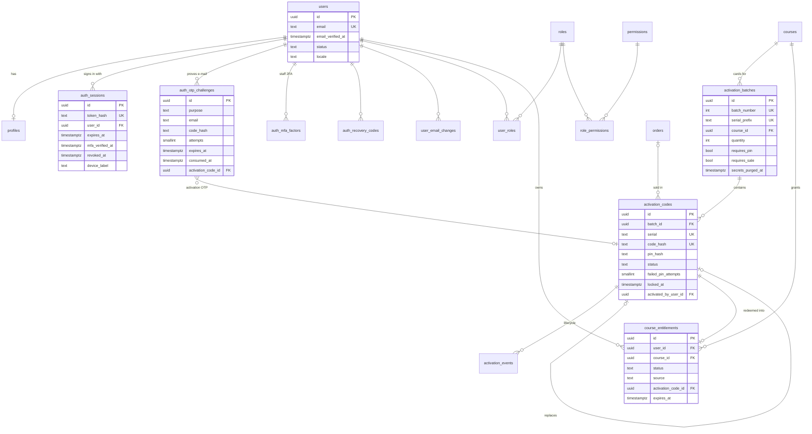
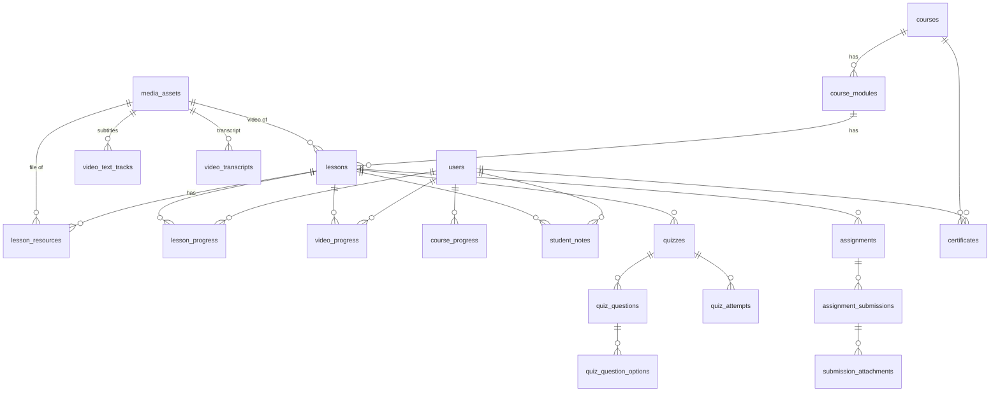
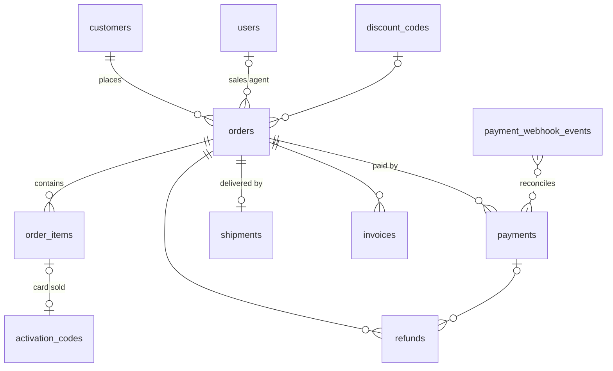
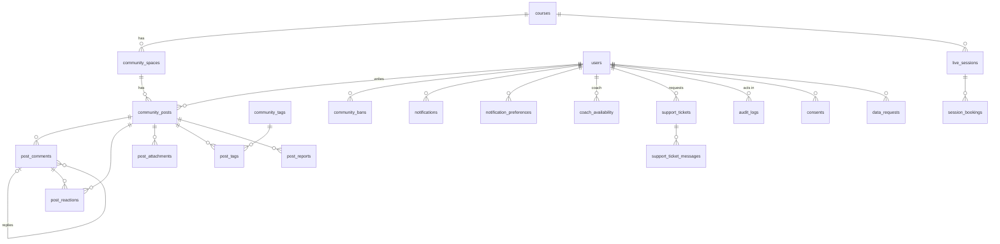

# Database

PostgreSQL 16+ · schema in `src/server/db/schema/*.ts` · SQL migrations in `drizzle/` · 68 tables.

## Conventions

| Topic        | Convention                                                                                                          |
| ------------ | ------------------------------------------------------------------------------------------------------------------- |
| Keys         | `uuid` primary keys generated as **UUIDv7** by the app (time-ordered), `gen_random_uuid()` as DB fallback           |
| Time         | `timestamptz` everywhere                                                                                            |
| Enums        | `text` + `CHECK (... in (...))` — evolvable with plain migrations                                                   |
| Money        | integer **minor units** (`bigint`) + ISO currency (`DZD` default)                                                   |
| Translations | `jsonb` objects `{ "ar": "…", "fr": "…" }` (`LocalizedText`)                                                        |
| Soft delete  | `deleted_at` on user-facing content; users are anonymised, never hard-deleted                                       |
| Integrity    | FKs everywhere, CHECK constraints for state machines, partial unique indexes for invariants                         |
| Security     | RLS enabled on every table with no policies (blocks Supabase Data API roles); audit tables append-only via triggers |

## Business invariants enforced by the database

| Invariant                                                                | Mechanism                                                                                 |
| ------------------------------------------------------------------------ | ----------------------------------------------------------------------------------------- |
| One account per e-mail (case-insensitive)                                | `users_email_key` unique + `users_email_normalized_check` (`email = lower(btrim(email))`) |
| A card backs at most one entitlement, ever                               | `course_entitlements_activation_code_key` partial unique index                            |
| At most one active entitlement per (student, course)                     | `course_entitlements_active_key` partial unique index                                     |
| An activated card has an owner and a date                                | `activation_codes_activated_check`                                                        |
| Used/revoked cards keep no printable secret                              | `activation_codes_consumed_secrets_check`                                                 |
| A card is sold before `sold_at` is set (and vice-versa for revocation)   | `activation_codes_sold_check`, `activation_codes_revoked_check`                           |
| OTP attempts never exceed the maximum                                    | `auth_otp_challenges_attempts_check`                                                      |
| One active TOTP factor per staff member                                  | `auth_mfa_factors_one_active_key`                                                         |
| One verified answer per question                                         | `post_comments_one_verified_key`                                                          |
| One reaction per user per target                                         | `post_reactions_user_post_key`, `post_reactions_user_comment_key`                         |
| Order totals add up                                                      | `orders_amounts_check`, `order_items_total_check`                                         |
| Webhooks processed once                                                  | `payment_webhook_events_provider_event_key`, `integration_events_source_external_key`     |
| One parcel per order; a tracking number belongs to one order per carrier | `shipments_order_key`, `shipments_carrier_tracking_key`                                   |
| A delivered parcel has a delivery date                                   | `shipments_delivered_check`                                                               |
| A landing-page order is imported once                                    | `orders_external_key`                                                                     |
| Audit trail cannot be edited                                             | triggers `audit_logs_append_only`, `activation_events_append_only`                        |

## ERD

### Identity, access control, entitlements, activation



### Catalogue, learning and assessments



### Commerce



### Community, notifications, live sessions, support, platform



## Table catalogue

| Domain         | Tables                                                                                                                                                                                                                                        |
| -------------- | --------------------------------------------------------------------------------------------------------------------------------------------------------------------------------------------------------------------------------------------- |
| Identity       | `users`, `profiles`, `user_email_changes`, `auth_otp_challenges`, `auth_sessions`, `auth_mfa_factors`, `auth_recovery_codes`, `rate_limit_buckets`, `consents`, `data_requests`                                                               |
| Access control | `roles`, `permissions`, `role_permissions`, `user_roles`                                                                                                                                                                                      |
| Catalogue      | `courses`, `course_modules`, `lessons`, `lesson_resources`, `media_assets`, `video_text_tracks`, `video_transcripts`                                                                                                                          |
| Learning       | `lesson_progress`, `video_progress`, `course_progress`, `student_notes`                                                                                                                                                                       |
| Assessments    | `quizzes`, `quiz_questions`, `quiz_question_options`, `quiz_attempts`, `assignments`, `assignment_submissions`, `submission_attachments`, `certificates`                                                                                      |
| Activation     | `card_templates`, `activation_batches`, `activation_codes`, `activation_events`                                                                                                                                                               |
| Entitlements   | `course_entitlements`                                                                                                                                                                                                                         |
| Commerce       | `customers`, `discount_codes`, `orders` (+ `external_source/external_id`, `shipping_address`), `order_items`, `payments`, `refunds`, `invoices`, `payment_webhook_events`, `shipments` (+ sequences `order_number_seq`, `invoice_number_seq`) |
| Community      | `community_spaces`, `community_posts`, `post_attachments`, `post_comments`, `post_reactions`, `post_mentions`, `community_tags`, `post_tags`, `post_reports`, `community_bans`                                                                |
| Engagement     | `notifications`, `notification_preferences`, `email_deliveries`, `live_sessions`, `session_bookings`, `coach_availability`, `support_tickets` (+ `ticket_number_seq`), `support_ticket_messages`                                              |
| Platform       | `platform_settings`, `audit_logs`, `integration_events` (raw inbound messages, purged after 30 days)                                                                                                                                          |

## Migrations workflow

```bash
# 1. change src/server/db/schema/*.ts
npm run db:generate -- --name=describe_change   # writes drizzle/NNNN_describe_change.sql
# 2. review the SQL (and add RLS for new tables: ALTER TABLE ... ENABLE ROW LEVEL SECURITY)
# 3. apply
npm run db:migrate
npm run db:seed        # idempotent: permissions, roles, course shell, community spaces
```

Hand-written SQL (triggers, policies, data fixes) goes in a custom migration:
`npx drizzle-kit generate --custom --name=...`.

Production rules: migrations are additive and backwards-compatible with the running release
(expand → deploy → contract); never edit an applied migration; run `db:migrate` before switching traffic.

## Seeds

| Command               | Environments                                       | Creates                                                                                                                           |
| --------------------- | -------------------------------------------------- | --------------------------------------------------------------------------------------------------------------------------------- |
| `npm run db:seed`     | all (idempotent)                                   | permission catalogue, 7 system roles, main course shell, 7 community spaces, first Super Admin from `BOOTSTRAP_SUPER_ADMIN_EMAIL` |
| `npm run db:seed:dev` | development/test only (refuses staging/production) | demo curriculum (5 modules), one account per staff role (`*@academy.test`), a demo batch of 20 cards (10 sold)                    |
